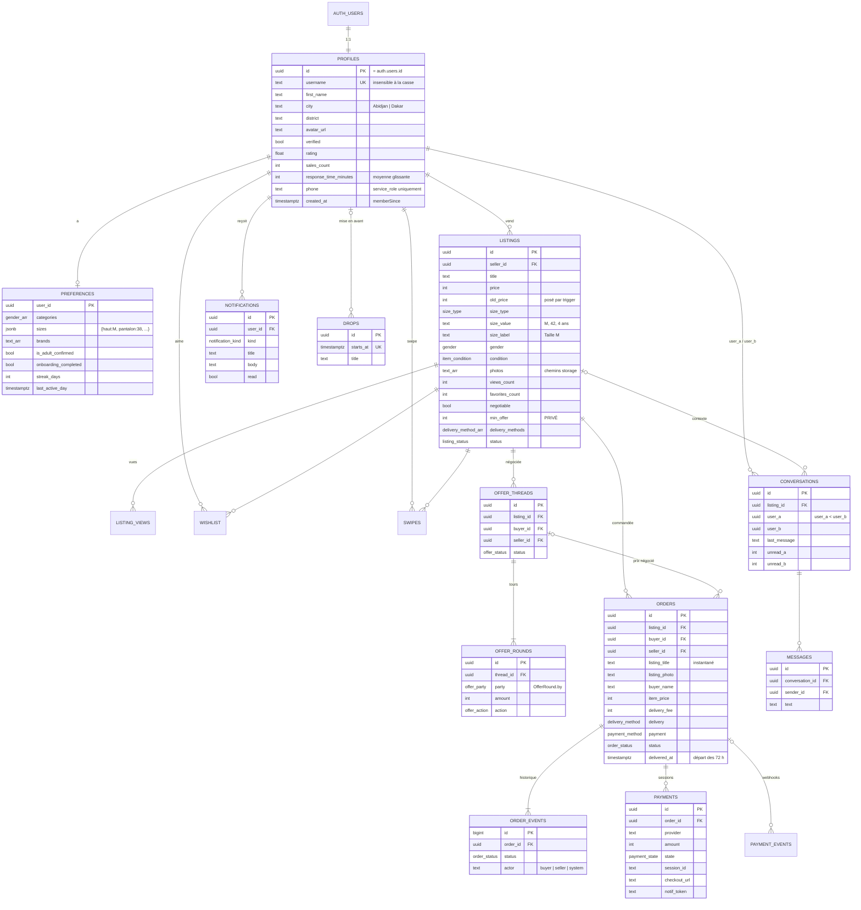
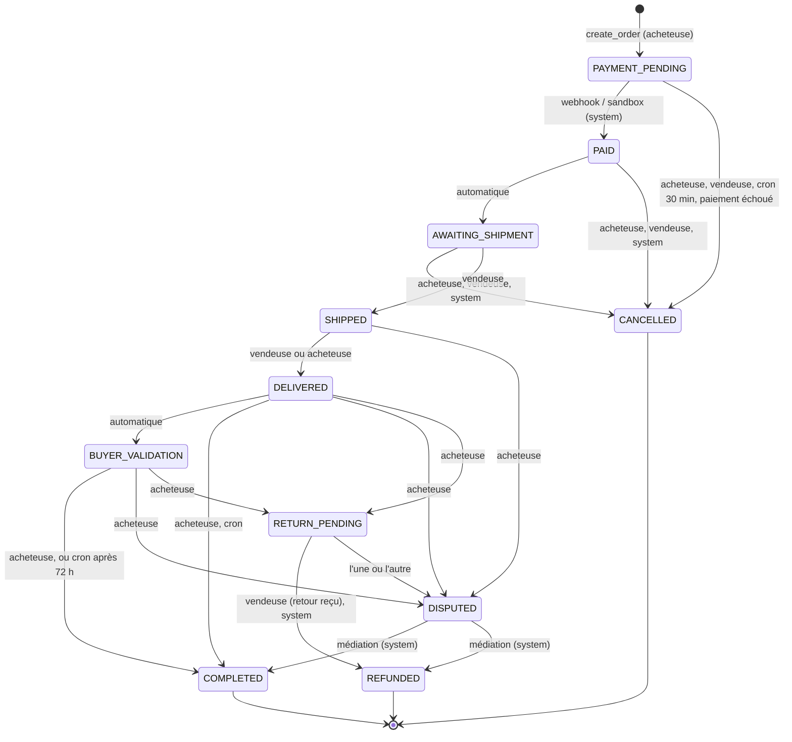

# ReFripe — backend Supabase

Postgres + RLS + RPC `security definer`, Storage, pg_cron et deux Edge Functions (Deno) pour le paiement en séquestre Wave / Orange Money.
L'app iOS passe exclusivement par `SupabaseRepository` (`ReFripe/Data/Supabase/`), qui implémente le protocole `Repository` du contrat. Sans clés Supabase, `makeRepository()` renvoie `DemoRepository`.

```
supabase/
  config.toml                         config locale (supabase start), OTP de test, verify_jwt des fonctions
  migrations/
    20261011000001_schema.sql         enums, tables, index, vues listings_public / my_conversations
    20261011000002_rls.sql            RLS + privilèges par table/colonne
    20261011000003_functions.sql      helpers (schéma private), machine à états, RPC
    20261011000004_triggers.sql       compteurs, baisse de prix, notifications, journal des commandes
    20261011000005_storage.sql        bucket listing-photos + policies
    20261011000006_cron.sql           pg_cron : séquestre 72 h, impayés, offres 48 h, drops, séries
  functions/
    _shared/{http,payments,supabase}.ts   PaymentProvider (sandbox, Wave, Orange Money), HMAC
    payment-init/index.ts             création de la session de paiement (JWT requis)
    payment-webhook/index.ts          notifications prestataires (signature, idempotent)
    .env.example                      variables des fonctions
  seed.sql                            6 profils, 9 annonces, commandes/offres/messages de démo
```

Toutes les règles métier vivent en SQL. Les montants sont des `integer` en FCFA (XOF n'a pas de centimes).

---

## 1. Schéma

Les enums Postgres reprennent exactement les `rawValue` Swift : `main_propre`, `orange_money`, `new_with_tags`, `PAYMENT_PENDING`, `counter_offer`, etc.



Vues :

| Vue | Rôle |
|---|---|
| `listings_public` | Catalogue : toutes les colonnes de `listings` **sauf `min_offer`**, annonces non retirées. Vue « definer » (propriétaire `postgres`) : c'est la seule porte d'entrée publique sur les annonces. Le linter Supabase la signale (`security_definer_view`) : c'est voulu. |
| `my_conversations` | `security_invoker` : conversations de l'utilisatrice avec `other_user_id` et `unread_count` calculés depuis `auth.uid()`. |

---

## 2. Machine à états des commandes



- Une seule fonction fait les transitions : `private.transition_order(order, status, actor)`. Le rôle est déduit de `auth.uid()` dans `advance_order`. `system` est réservé au webhook, aux crons et à la médiation (service_role).
- Le trigger `orders_after_status_change` écrit `order_events` (avec l'acteur) et notifie l'autre partie (`order_update`). Les états enchaînés automatiquement (`PAID`, `DELIVERED`) ne notifient pas.
- Effets de bord :
  - `create_order` passe l'annonce en `reserved` ;
  - `COMPLETED` la passe en `sold` et fait `sales_count + 1` chez la vendeuse ;
  - `CANCELLED`, ou `REFUNDED` après un retour, la remet en `active` ;
  - `REFUNDED` après un litige la passe en `removed`.
- `create_order` : prix = montant accepté du fil d'offre de l'acheteuse s'il existe (plafonné au prix), frais = `private.delivery_fee()` (miroir de `DeliveryMethod.fee` : relais 1 000, main propre 0, Yango 2 500), mode de livraison obligatoirement proposé par l'annonce. Un index unique interdit deux commandes « vivantes » sur la même annonce.

### Négociation

- `make_offer` (acheteuse) vérifie : annonce active et négociable, pas la sienne, `0 < montant < prix`, 3 offres max (`offer_limit_reached` → `RepositoryError.offerLimitReached`), une offre à la fois, et chaque offre doit dépasser la précédente. Une offre supérieure ou égale à la contre-offre en cours vaut acceptation de cette contre-offre. Un refus de la vendeuse (ou une expiration) clôt le fil (`offer_refused`) ; l'article reste achetable au prix affiché.
- `respond_offer` (vendeuse uniquement) : `accept`, `refuse`, ou `counter` avec un montant strictement compris entre la dernière offre et le prix. Pas de contre-offre après la 3e offre.
- L'article reste achetable au prix affiché par n'importe qui pendant la négociation. Les fils sans réponse depuis 48 h expirent (cron).
- `min_offer` reste un repère privé pour la vendeuse : le serveur ne refuse pas automatiquement les offres en dessous, pour ne pas révéler le plancher par tâtonnement.

---

## 3. Sécurité : RLS et privilèges

RLS est activée sur **toutes** les tables. Les privilèges Supabase par défaut sont révoqués, puis accordés au plus juste (par colonne quand c'est utile).

| Table | Lecture | Écriture directe |
|---|---|---|
| `profiles` | tout le monde, **sans `phone`** (privilèges par colonne) | sa ligne : `username, first_name, city, district, avatar_url`. Création via `complete_signup` |
| `preferences` | les siennes | les siennes |
| `listings` | **la vendeuse seulement** (avec `min_offer`) | insertion par la vendeuse avec des photos de son propre dossier storage. Mise à jour des colonnes éditoriales et du prix, seulement si l'annonce est `active`. `status`, `views_count`, `favorites_count` et `old_price` ne sont jamais modifiables par le client |
| `listings_public` | tout le monde (sans `min_offer`) | — |
| `listing_views` | — | via `record_view` |
| `wishlist`, `swipes` | les siennes | les siennes |
| `offer_threads`, `offer_rounds` | acheteuse et vendeuse du fil | via `make_offer` / `respond_offer` |
| `orders`, `order_events` | acheteuse et vendeuse | via `create_order` / `advance_order` |
| `payments`, `payment_events` | service_role | service_role |
| `conversations` / `my_conversations` | participantes | via `get_or_create_conversation` |
| `messages` | participantes | insertion par une participante, `sender_id = auth.uid()` |
| `notifications` | les siennes | colonne `read` uniquement |
| `drops` | tout le monde | — |
| `storage.objects` (`listing-photos`) | public | dossier `<auth.uid()>/…` uniquement |

RPC : toutes en `security definer`, avec `set search_path = ''` et noms qualifiés. Elles commencent par `private.require_uid()`. `EXECUTE` est révoqué de `PUBLIC` et `anon`, puis accordé à `authenticated` fonction par fonction. `confirm_payment` et `fail_payment` sont réservées à `service_role`. Les helpers internes vivent dans le schéma `private`, non exposé par PostgREST.

Erreurs : `raise exception '<message FR>' using hint = '<code>'`. `SupabaseRepository` traduit `hint`/`code` en `RepositoryError` (`offer_limit_reached`, `not_authenticated`, `not_found`) et affiche sinon le message tel quel.

---

## 4. RPC exposées

| RPC | Appelée par |
|---|---|
| `complete_signup(p_username, p_first_name, p_city, p_district, p_is_adult)` → profil | `completeSignup` |
| `record_view(p_listing_id)` (dédoublonnée 30 min, jamais la vendeuse) | `recordView` |
| `swipe_deck(p_limit)` → lignes `listings_public` non swipées, catégories préférées d'abord | `swipeDeck` |
| `next_drop()` → `timestamptz` | `nextDropDate` |
| `make_offer(p_listing_id, p_amount)` → thread id | `makeOffer` |
| `respond_offer(p_thread_id, p_action, p_amount)` → thread id | `respondToOffer` |
| `create_order(p_listing_id, p_delivery, p_payment)` → order id | `createOrder` (puis Edge Function `payment-init`) |
| `advance_order(p_order_id, p_status)` | `advanceOrder` |
| `get_or_create_conversation(p_other_user, p_listing_id)` | `conversation(withUser:listingId:)` |
| `mark_conversation_read(p_conversation_id)` (remet aussi les notifications `message` à lu) | `markConversationRead` |
| `seller_stats()` → objet aux clés de `SellerStats` | `sellerStats` |
| `seller_recommendations()` → tableau de `SellerRecommendation` (max 4) | `recommendations` |

`seller_stats` compare le mois en cours (à date) au mois précédent (UTC = heure d'Abidjan et de Dakar). Les vues de la semaine vont du lundi au dimanche. Objectif mensuel = +20 % sur le CA du mois dernier, arrondi à 5 000 FCFA, minimum 50 000. Paliers mensuels : Bronze < 3 ventes, Argent 3–6, Or 7–14, Platine ≥ 15.

`seller_recommendations` applique des règles inspirées de la maquette :
1. commande payée à expédier ;
2. ≥ 50 vues et aucune vente après 14 jours → baisse de prix suggérée (−10 %, arrondie au pas d'offre) ;
3. moins de 4 photos ;
4. article le plus vu → partage WhatsApp ;
5. temps de réponse (≤ 15 min : bravo, > 1 h : conseil) ;
6. aucune annonce active.

## 5. Triggers et tâches planifiées

| Événement | Effet |
|---|---|
| Baisse de `listings.price` | `old_price` = prix précédent (cumulé), `min_offer` annulé s'il dépasse le nouveau prix, notification `price_drop` à chaque personne qui a l'article en envie |
| Nouvelle annonce | ville/quartier copiés du profil, notification `new_in_size` aux personnes dont `preferences.categories` contient le genre **et** `sizes[size_type] = size_value` |
| Nouveau tour d'offre | notification `counter_offer` à l'autre partie (contre-offre, acceptation, refus, nouvelle offre) |
| Nouveau message | `last_message`, `unread_*` +1 pour la destinataire, notification `message` (une seule non lue par conversation, rafraîchie), temps de réponse moyen de l'expéditrice |
| Changement de statut de commande | `order_events` + notification `order_update` |
| Wishlist | `favorites_count` ± 1 |

| Job pg_cron | Fréquence |
|---|---|
| `refripe-release-escrow` : DELIVERED/BUYER_VALIDATION depuis 72 h → COMPLETED | 15 min |
| `refripe-cancel-unpaid-orders` : PAYMENT_PENDING depuis 30 min → CANCELLED | 5 min |
| `refripe-expire-offers` : fils `pending` sans réponse depuis 48 h, ou article plus en vente → `expired` | 30 min |
| `refripe-rotate-drop` : garantit un prochain drop (12:00 et 19:00 UTC) et met en avant la vendeuse la plus active de la semaine | 10 min |
| `refripe-streak-reminders` : rappel « Série de N jours » | 17:00 UTC |

---

## 6. Paiement (Edge Functions)

```
App ──create_order (RPC)──▶ Postgres : commande PAYMENT_PENDING, annonce reserved
App ──payment-init {order_id} + JWT──▶ Edge Function
        ├─ sandbox : confirm_payment() immédiat → PAID → AWAITING_SHIPMENT
        └─ live    : session Wave / Orange Money → checkout_url (ouverte par l'app)
Wave / OM ──POST payment-webhook?provider=…──▶ vérification signature → payment_events (idempotence)
        └─ confirm_payment() / fail_payment() (service_role)
```

- `PaymentProvider` (`_shared/payments.ts`) a trois implémentations :
  - `SandboxProvider` : confirmation automatique, webhook signé `x-refripe-signature: t=…,v1=HMAC` ;
  - `WaveProvider` : API Checkout, webhook `Wave-Signature: t=…,v1=…` en HMAC-SHA256 ;
  - `OrangeMoneyProvider` : Web Pay, vérification du `notif_token`.
- Les `TODO(Wave)` et `TODO(Orange Money)` marquent ce qui doit être validé avec les contrats marchands : champs exacts, signature des requêtes, Orange Money Sénégal (API Sonatel), IP sources.
- `confirm_payment` est idempotent. Elle vérifie que le montant est égal à `item_price + delivery_fee`. Un paiement reçu après l'annulation automatique (30 min) est journalisé pour remboursement manuel.
- Si `payment-init` échoue, l'app annule la commande, ce qui libère l'annonce.

Tester le webhook sandbox à la main (avec `SANDBOX_AUTO_CONFIRM=false`) :

```bash
BODY='{"id":"evt_test_1","order_id":"<uuid>","status":"succeeded","amount":5500}'
T=$(date +%s)
SIG=$(printf '%s%s' "$T" "$BODY" | openssl dgst -sha256 -hmac "$SANDBOX_WEBHOOK_SECRET" | sed 's/^.* //')
curl -X POST "$SUPABASE_URL/functions/v1/payment-webhook?provider=sandbox" \
  -H "x-refripe-signature: t=$T,v1=$SIG" -H 'Content-Type: application/json' -d "$BODY"
```

---

## 7. Déploiement

Prérequis : Supabase CLI ≥ 2.x, Docker pour le local.

### En local

```bash
supabase start                      # applique migrations + seed.sql
cp supabase/functions/.env.example supabase/functions/.env
supabase functions serve --env-file supabase/functions/.env
```

Connexion locale par SMS sans fournisseur : numéros du seed et code `123456` (voir `[auth.sms.test_otp]`). Par exemple `+2250700000001` pour Awa_Style225.

### Projet hébergé

```bash
supabase login
supabase link --project-ref <ref>   # Settings → General → Reference ID
supabase db push                    # applique supabase/migrations (pas le seed)

supabase secrets set PAYMENT_MODE=sandbox SANDBOX_WEBHOOK_SECRET=$(openssl rand -hex 32)
# en live :
supabase secrets set PAYMENT_MODE=live WAVE_API_KEY=… WAVE_WEBHOOK_SECRET=… \
  OM_CLIENT_ID=… OM_CLIENT_SECRET=… OM_MERCHANT_KEY=… OM_COUNTRY=ci

supabase functions deploy payment-init
supabase functions deploy payment-webhook --no-verify-jwt
```

- `major_version` dans `config.toml` doit correspondre à la version Postgres du projet (17 par défaut). Les fonctions utilisent `date_trunc(…, 'UTC')`, qui demande Postgres ≥ 14.
- pg_cron : si `create extension pg_cron` est refusé, active l'extension dans Database → Extensions, puis relance `supabase db push`. Vérifie les jobs avec `select * from cron.job;`.
- URL des webhooks à déclarer chez les prestataires : `https://<ref>.supabase.co/functions/v1/payment-webhook?provider=wave` (Wave Business → Développeurs → Webhooks). Pour Orange Money, l'URL est transmise automatiquement dans `notif_url`.
- Après la mise en production, garde `seed.sql` pour le local uniquement.

### Authentification (dashboard Supabase)

**OTP par SMS** : Authentication → Sign In / Providers → **Phone**.
1. Active « Enable Phone provider » et « Enable phone confirmations ».
2. Choisis un fournisseur : Twilio (ou Twilio Verify), MessageBird, Vonage ou Textlocal. Twilio et Vonage couvrent la Côte d'Ivoire (+225) et le Sénégal (+221). Pense à un Sender ID alphanumérique « ReFripe » s'il est autorisé dans le pays.
3. Renseigne les identifiants (ex. Twilio : Account SID, Auth Token, Message Service SID).
4. Modèle du message : `Ton code ReFripe : {{ .Code }}`. Longueur d'OTP : 6, expiration : 300 s.
5. Authentication → Rate Limits : ajuste les envois de SMS par heure.

L'app envoie les numéros au format E.164 (`+2250700000001`).

**Sign in with Apple** (natif, `signInWithIdToken`) :
1. Apple Developer → Identifiers → l'App ID `dev.eugenebessan.refripe` : coche « Sign In with Apple ». L'entitlement est déjà dans `project.yml`.
2. Supabase → Authentication → Sign In / Providers → **Apple** → Enable.
3. Dans « Client IDs », ajoute le Bundle ID `dev.eugenebessan.refripe`. Pour le flux natif iOS, pas besoin de Services ID ni de clé secrète. Ils ne servent qu'au flux web OAuth.
4. Côté app, la vue d'onboarding transmet l'`idToken` et le **nonce brut** à `signInWithApple(idToken:nonce:)`. Apple reçoit le SHA-256 du nonce.

### Clés côté app : `Config/Secrets.local.xcconfig`

Ce fichier est ignoré par git et inclus par `Config/Secrets.xcconfig`. Crée-le avec :

```
SUPABASE_URL = https:/$()/<ref>.supabase.co
SUPABASE_ANON_KEY = eyJhbGciOi…   // Settings → API → anon public (ou clé « publishable »)
```

Le `/$()/` est nécessaire car `//` commence un commentaire dans un xcconfig. En local : `SUPABASE_URL = http:/$()/127.0.0.1:54321` et la clé `anon` affichée par `supabase start` (sur un appareil physique, remplace 127.0.0.1 par l'IP du Mac et autorise HTTP via ATS).

Ensuite : `xcodegen generate`, puis build. `AppConfig` lit ces valeurs dans Info.plist. Vides ou absentes, l'app démarre en mode démo.

**Ne mets jamais la clé `service_role` dans l'app.**

---

## 8. Correspondance avec le contrat Swift

- `OfferRound.by` est stocké dans la colonne `offer_rounds.party`, car `by` est un mot réservé gênant en PL/pgSQL.
- `Listing.views` correspond à `views_count`. `ListingDraft.sizeValue` est stocké dans `size_value` (sert à l'alerte `new_in_size`) et `sizeLabel` est calculé via `SizeType.displayLabel(for:)`.
- `ListingPhoto` : `photos` contient des chemins storage (`<uid>/<listing>/<n>.jpg`), convertis en URL publiques. Les URL absolues, utilisées par le seed, sont acceptées telles quelles.
- `UserPreferences.sizes` (`[SizeType: String]`) est stocké en `jsonb` avec des clés texte. JSONEncoder encoderait sinon le dictionnaire en tableau.
- `swipeDeck(preferences:)` ignore le paramètre : les préférences sont lues côté serveur.
- `UserProfile.rating` n'est alimenté par aucune RPC (il n'y a pas d'avis dans le protocole). La valeur vient du seed ou d'une mise à jour admin.
